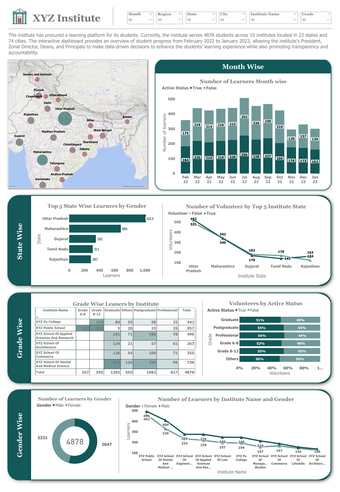

# XYZ Institute Learner Dashboard (Power BI)

An interactive **Power BI** dashboard that gives a chain of institutes one view of learner numbers by month, state, grade and gender, so that leadership can see where learners are, how numbers moved over the year and which groups need attention.

Case-study project from the Infosys Springboard virtual internship (January to May 2023), project title *Visual Dashboard for an Enterprise*. Built by a four-person Scrum team; see "My contribution" below.



## Business problem

"XYZ Institute" is a fictional case-study client with a chain of institutes in several cities. It had procured a learning platform and wanted its analytics team to turn the platform's learner data into dashboards for its President, Zonal Director, Deans and Principals, covering:

- monthly growth of learners
- state-wise learners
- grade-wise learners
- gender-wise learners
- state-wise and grade-wise volunteers

## The data

A synthetic learner dataset supplied by the internship programme (not redistributed here), one row per learner:

| Field | Description |
|---|---|
| Student name, email | fictional |
| First login date | MM/DD/YYYY |
| Active status | true or false |
| Gender | male or female |
| Institute name, city, state | location of the institute |
| Grade | Grade 6-8, Grade 8-12, Graduate, Postgraduate, Professional, Others |
| Volunteer | true or false |

**Scale shown on the dashboard:** 4,878 learners, 10 institutes, 22 states and 74 cities, from February 2022 to January 2023.

## What the dashboard shows

- **Month wise:** learners by first-login month, split by active status (July 2022 is the busiest month with 508 learners).
- **State wise:** the top five states by learners (Uttar Pradesh 1,013; Maharashtra 682; Gujarat 352; Tamil Nadu 311; Rajasthan 287), a map of learners by state, and volunteers by top-five state.
- **Grade wise:** a learner matrix by institute and grade, and volunteers by active status.
- **Gender wise:** a donut chart of the total (4,878) and learners by institute and gender.
- **Filters:** month, region, state, city, institute name and grade apply across the page.

## Process

1. Wrote **user stories** with the team (for example "as an analytics team member I want to access and analyse grade data for all primary-grade students across all campuses, so that I can identify areas for improvement in the curriculum").
2. Tracked the backlog and sprint progress in **Excel** and worked in Scrum sprints.
3. Cleaned and modelled the data in **Power BI** (data modelling, DAX measures) and built one report per user story, then combined them into the overview page above.
4. Presented the dashboards to a non-technical audience.

## My contribution

The overview dashboard is the team's combined output. My own reports were the **state-wise learners report (user story 2)**, with a top-10 states-by-gender bar chart, a map of learners by state, a total-learner gauge and an active-status chart, and the **state-wise volunteers report (user story 5)**, with slicers for month, region, state, city, institute and grade, a map and a 100% stacked bar of volunteers by top-five state and active status.

## Tools

Power BI Desktop (data modelling, DAX, slicers, maps), Excel (backlog and sprint tracking), Scrum.

## Limitations

- The data is synthetic and the institute is fictional, so the numbers illustrate the dashboard design and not a real organisation.
- The `.pbix` file embeds the supplied dataset, so it is not published here.

## Repository layout

```
README.md
images/   dashboard screenshot
docs/     the project brief summary and user stories
```

## Author

Shravani Umbarje, Business Intelligence Intern (Infosys Springboard Internship Programme, virtual), January to May 2023.

Documentation: MIT licence (see `LICENSE`). The dataset and project brief belong to the internship programme and are not redistributed.
